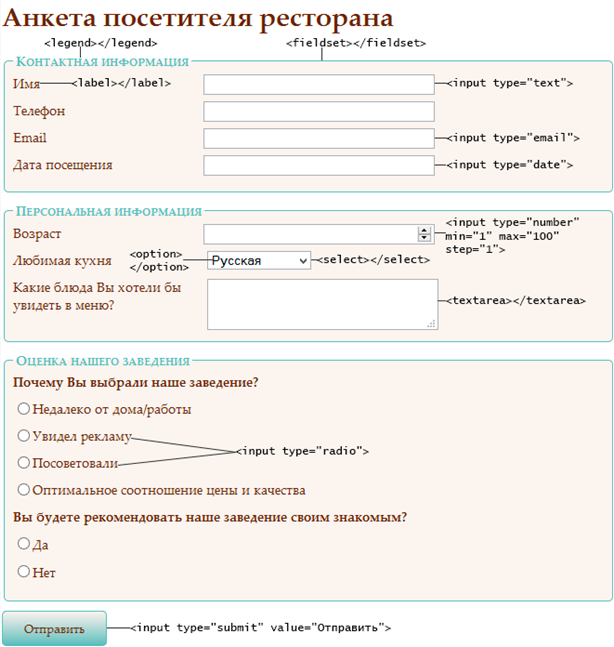

# Создание формы на html-странице

| | |
|---|---|
| Предмет | Проектирование и разработка интерфейсов пользователя (ПиРИП) |
| Раздел курса | Основы web-технологий |
| Задание | Лабораторное задание «Создание формы на html-странице» |
| Дата сдачи | 19.11.2026 |
| Статус | Отправлено для оценивания, попытка 1 |
| Оценка | пока не выставлена |

## Что требовалось

1. Создать форму по образцу, приведённому в задании.
2. Показать работу преподавателю и прикрепить HTML-файл в Moodle.



## Что сделано

Одностраничная анкета посетителя ресторана на чистом HTML и CSS, без внешних
библиотек.

- заголовок и три набора полей — `fieldset` с `legend`;
- контактные поля: имя, телефон, email, дата посещения;
- возраст через `input type="number"` с ограничением 1–100;
- выпадающий список кухонь через `select`;
- многострочное поле пожеланий через `textarea`;
- две группы радиокнопок: причина выбора и рекомендация;
- кнопка «Отправить»;
- адаптивность: при ширине до 520 px подписи и поля встают в колонку.

Что проверяют в такой работе: форма выглядит как на образце, все поля на месте,
подписи связаны с полями через `label for`, вёрстка не разъезжается на узком экране.

## Файлы

| Файл | Что это |
|---|---|
| `form.html` | сама лабораторная |
| `образец.png` | образец формы из задания |
| `результат.png` | как форма выглядит в браузере |

## Как открыть

Двойным щелчком по `form.html`. Или из терминала:

```bash
start form.html      # Windows
xdg-open form.html   # Linux
open form.html       # macOS
```

## Статус сдачи

Moodle: **«Отправлено для оценивания»**, попытка 1, файл `form.html`, оценка пока
не выставлена. Пока работа не оценена, ответ можно отредактировать.

Отдельный пункт задания — «Покажите выполненное задание преподавателю» — выполняется
вживую на паре.
